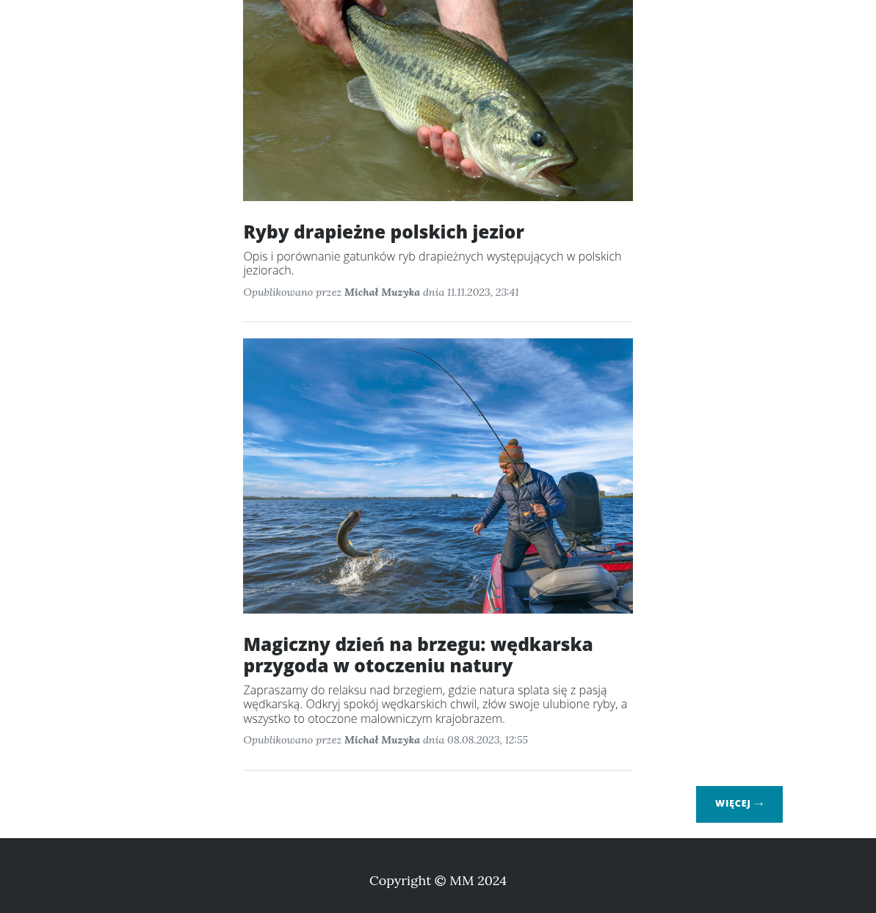
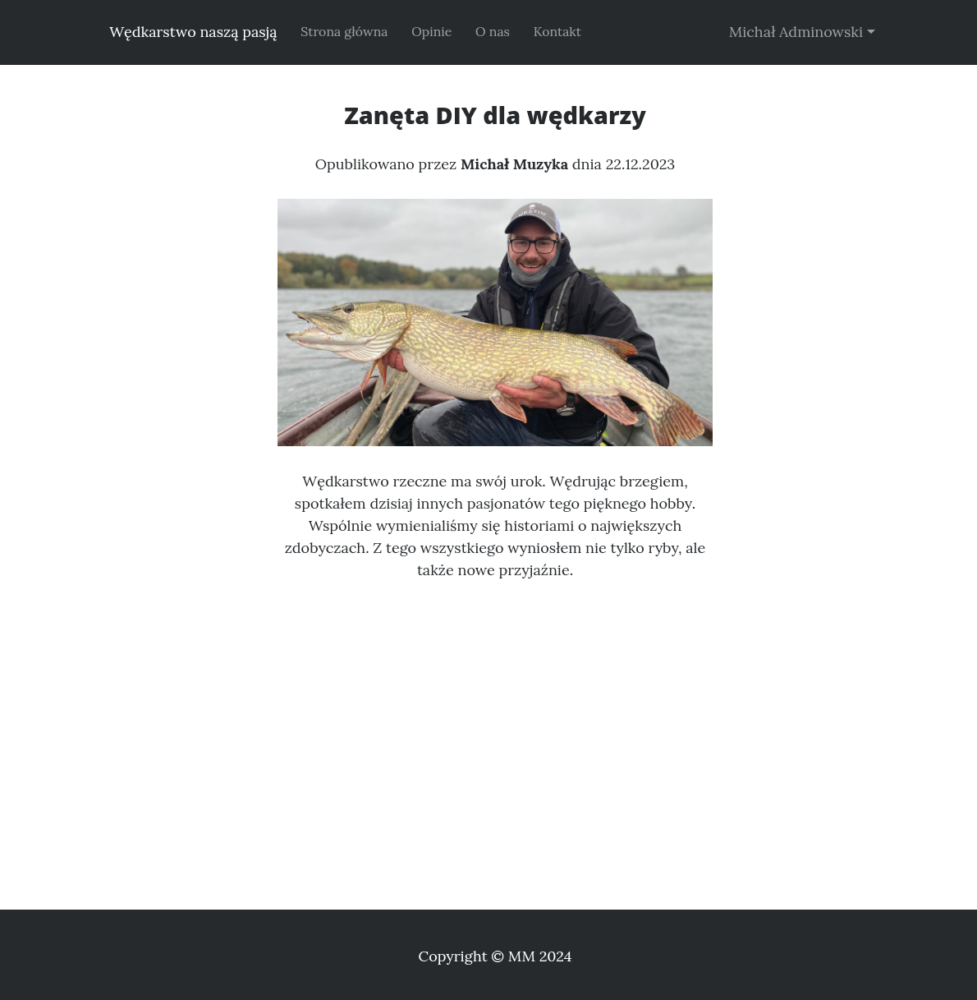
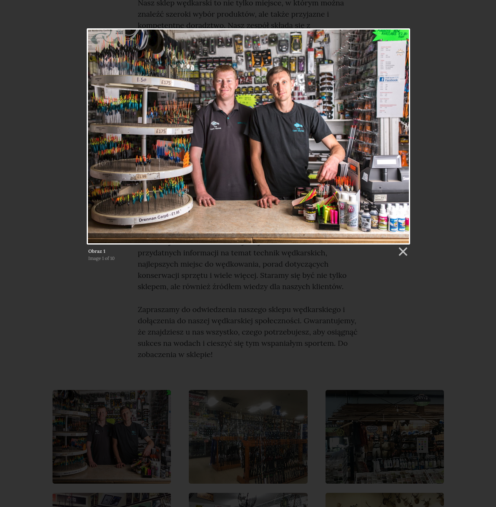
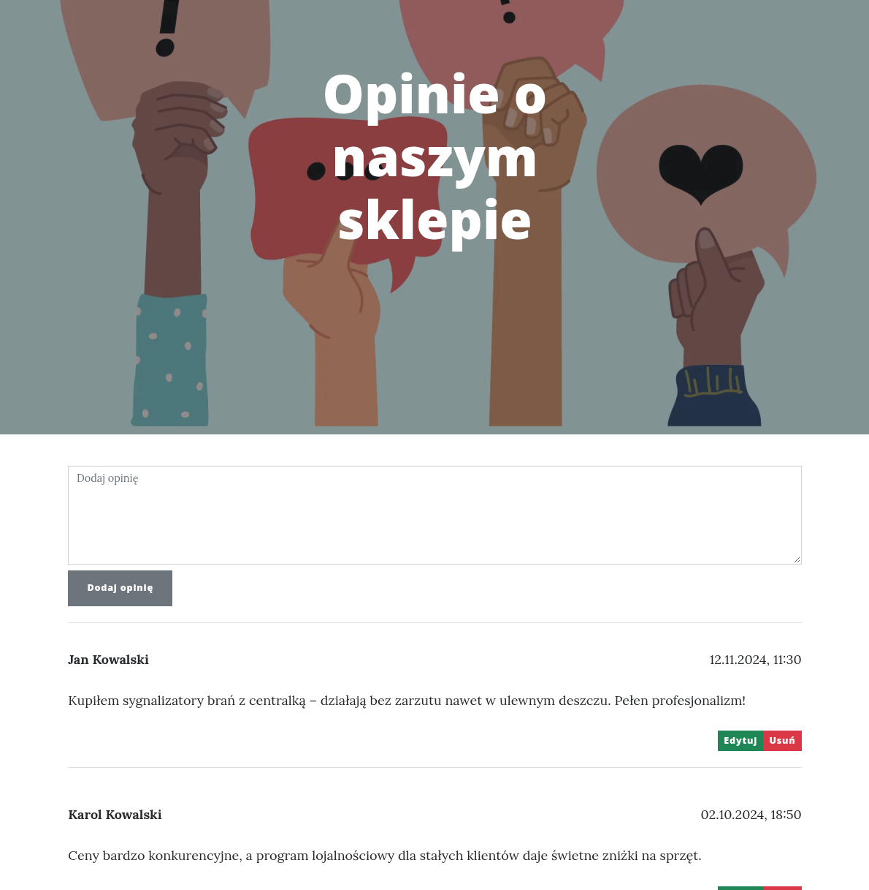
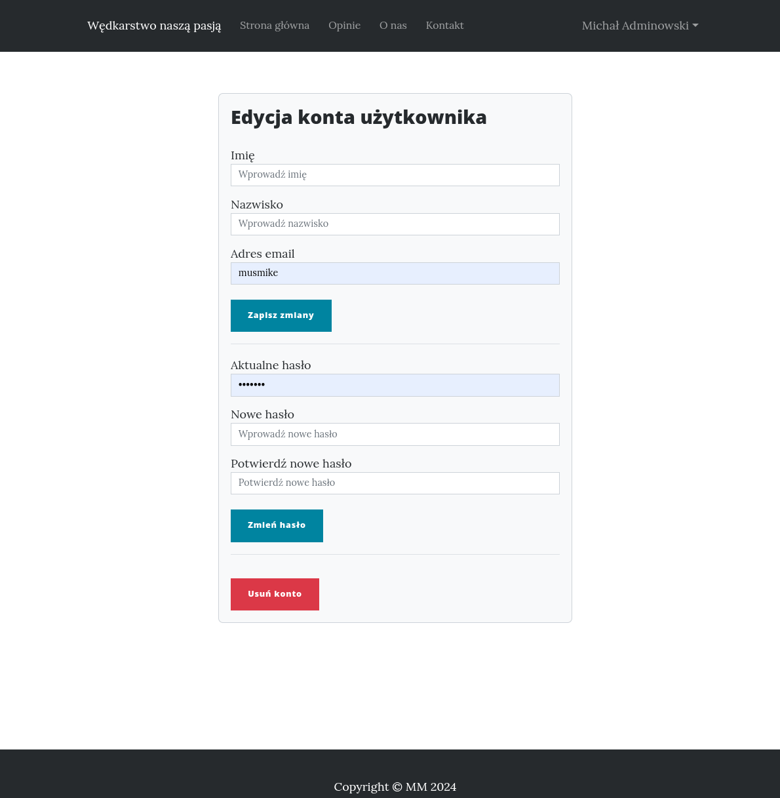

# Fishing Website (MERN Stack)

A web application and portal for a fishing store.

The portal allows the store to publish various articles about fishing, while customers can share their opinions and reviews. It also features a gallery and description showcasing the store, contact details, and user account management, built with MongoDB, Express.js, React, and Node.js.

---

## Screenshots

| Home & Blog Overview | Home & Blog Overview |
|:---:|:---:|
|  |  |

| Article Reading View | Shop Showcase & Lightbox Gallery |
|:---:|:---:|
|  |  |

| Customer Reviews & Ratings | User Profile & Authentication |
|:---:|:---:|
|  |  |

---

## Features

- **Blog & Article Feed:** Paginated fishing articles and tips with an animated header slideshow and dynamic article navigation.
- **Interactive Store Showcase:** Photo gallery of the store interior and fishing gear powered by Lightbox2 and jQuery.
- **Customer Reviews (CRUD):** Authenticated users can submit, browse, update, and delete store reviews with real-time feedback.
- **Role-Based Moderation:** Administrator users have elevated privileges to moderate and delete any customer reviews across the portal.
- **User Profile Management:** Users can update their personal information (first name, last name, email) or change passwords with Joi schema validation.
- **Authentication:** JWT-based user authentication with BCrypt password hashing and protected routing (`react-router-dom`).
- **Automatic Database Seeding:** The backend automatically verifies and populates MongoDB with realistic articles, users, and store reviews on startup.

---

## Tech Stack

- **Backend:** Node.js, Express.js 4, Mongoose 8 (MongoDB ODM), JSON Web Tokens (JWT), BCrypt.js, Joi, Swagger UI (OpenAPI 3.0)
- **Frontend:** React 18, Vite, React Router 6, React-Bootstrap, Axios, Lightbox2, jQuery
- **Database:** MongoDB 6
- **Testing:** Node.js Built-in Test Runner (`node:test`, `node:assert`), Vitest
- **Deployment:** Docker, Docker Compose

---

## API Documentation (Swagger UI)

The backend provides interactive API documentation powered by **Swagger UI (OpenAPI 3.0)** with full JWT Bearer authorization support.

When running the application (via Docker or locally), the Swagger UI is available at:
👉 **[http://localhost:5000/swagger](http://localhost:5000/swagger)** *(navigating to `http://localhost:5000` automatically redirects to Swagger UI)*

An offline OpenAPI 3.0 specification file is also available in the repository at [`docs/swagger.json`](docs/swagger.json).

### Available Endpoints

| Method | Endpoint | Access | Description |
|---|---|---|---|
| `POST` | `/auth/register` | Public | Register a new user account |
| `POST` | `/auth/login` | Public | Authenticate user and receive a JWT Bearer token |
| `GET` | `/api/posts` | Public | Retrieve paginated fishing blog posts (`?page=1`) |
| `GET` | `/api/post/{id}` | Public | Retrieve details of a specific blog post by ID |
| `GET` | `/api/reviews` | Public | Retrieve all customer store reviews with author details |
| `POST` | `/api/review` | Bearer Token | Submit a new customer review |
| `PATCH` | `/api/review/{id}` | Bearer Token | Update an existing review (author or admin) |
| `DELETE` | `/api/review/{id}` | Bearer Token | Delete a review (author or admin) |
| `PATCH` | `/api/user` | Bearer Token | Update user profile details or change password |
| `DELETE` | `/api/user` | Bearer Token | Permanently delete authenticated user account |

### How to Test Endpoints in Swagger UI

1. Open **[http://localhost:5000/swagger](http://localhost:5000/swagger)** in your browser.
2. Under the **Auth** section, expand `POST /auth/login`, click **Try it out**, and submit the demo credentials:
   ```json
   {
     "email": "admin@wp.pl",
     "password": "Admin123!"
   }
   ```
3. Copy the `data` string (JWT token) from the JSON response body.
4. Click the green **Authorize** button (🔓) located at the top-right of Swagger UI.
5. In the input field (`bearerAuth`), paste **only** the copied token string (do **not** include the word `Bearer`; Swagger UI automatically adds the `Bearer ` prefix):
   ```text
   <your_copied_token>
   ```
   *(or paste `<your_copied_token>` into the `ApiKeyAuth` field)*
6. Click **Authorize**, then **Close**.
7. You can now execute requests against protected endpoints under **Reviews** and **User** directly from your browser.

---

## Quick Start (Docker)

### Requirements
- [Docker Engine & Docker Compose](https://docs.docker.com/get-docker/)

### 1. Clone the repository
```bash
git clone https://github.com/musmike/fishing-website-MERN.git
cd fishing-website-MERN
```

### 2. Configure environment variables
Copy the example environment file:
```bash
cp .env.example .env
```
*(The backend and frontend also automatically initialize `.env` from `.env.example` if not already present).*

### 3. Build and start the services
```bash
docker compose up -d --build
```

### 4. Open in browser
- **Frontend App:** [http://localhost:3000](http://localhost:3000)
- **Swagger UI:** [http://localhost:5000/swagger](http://localhost:5000/swagger)

### Demo Credentials
The database is automatically seeded on startup with realistic demo accounts:
- **Administrator:**
  - **Email:** `admin@wp.pl`
  - **Password:** `Admin123!`
- **Standard User:**
  - **Email:** `user@wp.pl` *(or `michal@wp.pl`)*
  - **Password:** `User123!`

---

## Running Tests

### Backend Tests (Node.js Test Runner)
```bash
cd backend
npm test
```
*Executes unit and integration test suites verifying OpenAPI 3.0 specification validity, MongoDB seed data completeness, JWT Bearer authentication middleware logic, automatic `.env` initialization, and user schema validation.*

### Frontend Tests
```bash
cd frontend
npm test
```
*Validates Vite application configuration, React component structure, index entry point, and API client utilities.*

---

## Architecture & Ports

| Service | Technology | Port (Host) | Description |
|---|---|---|---|
| Frontend (`frontend`) | React 18 & Vite | `http://localhost:3000` | Web application user interface |
| Backend & Swagger (`backend`) | Node.js / Express.js | `http://localhost:5000` | REST API (`/swagger` for docs) |
| Database (`db`) | MongoDB 6 | `localhost:27017` | MongoDB database instance |
